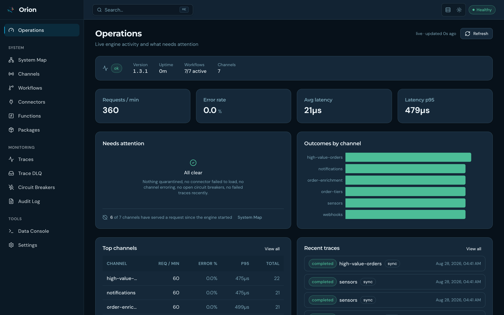
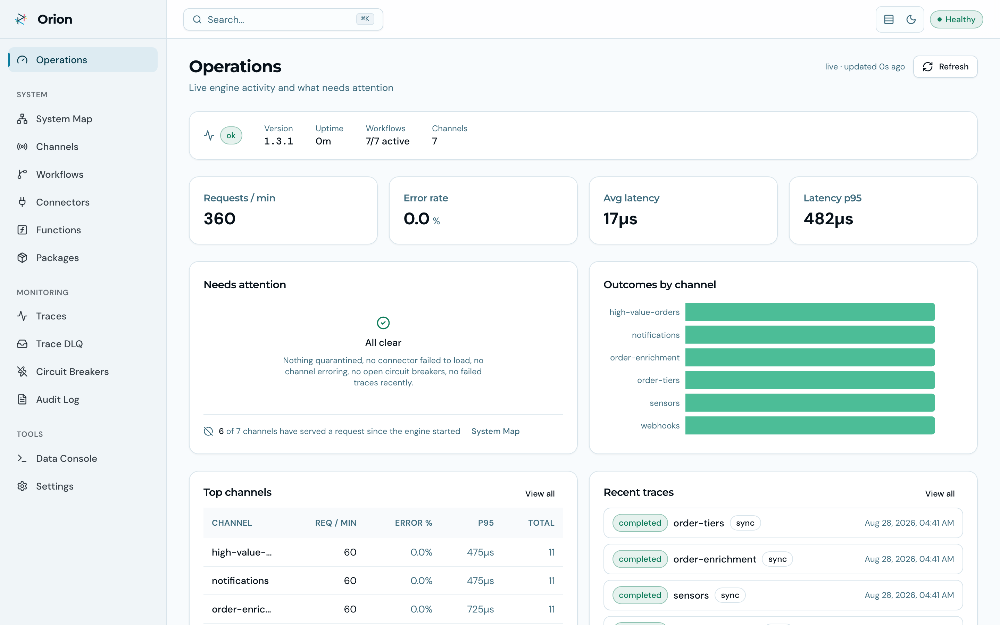

<!-- description: Configure JSON logs, Prometheus metrics, OpenTelemetry tracing, and health probes (/healthz, /readyz, /health), plus key production alert signals. -->
<!-- type: guide -->
<!-- last_verified: 2026-11-16 -->

# Monitoring, metrics, and alerts

Orion emits structured JSON logs, Prometheus metrics, OpenTelemetry distributed traces, and three HTTP health endpoints directly from the server binary without requiring sidecar agents.

---

## 1. Structured logging

Configure the log level and output format in `orion.toml`:

```toml
[logging]
level = "info"      # trace, debug, info, warn, error
format = "json"     # json for production log aggregators, pretty for local terminals
```

Use `RUST_LOG` when you need per-crate granularity (for example, `RUST_LOG=orion=debug,tower_http=warn,sqlx=warn`). Every request carries an `x-request-id` header (accepted from the caller or generated by Orion), which is echoed on the HTTP response and attached to every log line and trace span for that request.

---

## 2. Prometheus metrics

Enable the Prometheus exporter and bind it to an internal listener address so your scraper does not need an admin API key:

```toml
[metrics]
enabled = true
bind_addr = "127.0.0.1:9090"
```

When `bind_addr` is set, Orion serves `GET /metrics` on that dedicated listener and removes `/metrics` from the main HTTP port (`8080`). Every metric uses the `orion_` prefix and, in cluster mode, carries an `instance` label identifying the replica.

### Pinpointing latency with nested histograms

Orion exports three nested duration histograms so you can isolate whether latency comes from engine evaluation, data transformation tasks, or external connector I/O:

```promql
# 1. Engine overhead (condition evaluation, loop bookkeeping, guard checks):
  sum(rate(orion_workflow_duration_seconds_sum[5m])) by (workflow)
- sum(rate(orion_task_duration_seconds_sum[5m]))     by (workflow)

# 2. External backend I/O vs in-memory task execution:
  sum(rate(orion_task_duration_seconds_sum[5m]))              by (workflow)
- sum(rate(orion_connector_request_duration_seconds_sum[5m])) by (workflow)
```

---

## 3. Production alerts to configure

Beyond standard HTTP error rate and P99 latency alerts, configure alerts for these six operational signals that do not fail loud user requests when they degrade:

| Signal | Metric / Expression | Why it matters |
|---|---|---|
| **Stalled background maintenance jobs** | `time() - orion_job_last_success_timestamp_seconds{job="..."} > 7200` | Trace cleanup, audit cleanup, and DLQ retry loops swallow transient tick errors by design. Alert on time since last success rather than error rate. |
| **Dropped audit events** | `increase(orion_audit_events_dropped_total[5m]) > 0` | Any increment means the audit writer queue (`audit.max_pending`) overflowed and an admin mutation was not recorded. |
| **Lost trace writes** | `increase(orion_trace_persistence_failures_total[5m]) > 0` | Counts trace rows that failed to write or were dropped on queue overflow. |
| **Growing or frozen trace DLQ** | `orion_trace_dlq_depth > 0` (with `trace_queue.dlq_retry_enabled = true`) | Indicates failed async workflow runs accumulating in `trace_dlq`. Note: if `dlq_retry_enabled = false`, this gauge stops updating. |
| **Cron schedule lag & lease loss** | `orion_cron_schedule_lag_seconds`, `orion_cron_pending_occurrences`, and `increase(orion_cron_lease_renewal_failures_total[5m]) > 0` | Detects when scheduled jobs are produced faster than workers complete them, or when a running job lost its database lease mid-run. |
| **Deprecated query-string trace tokens** | `increase(orion_trace_token_query_reads_total[1h]) > 0` | Tracks callers still passing `?token=` in URLs instead of the `x-trace-token` header. |

### Standard & Enterprise alerts <span class="edition-badge edition-standard-plus" title="Available in Orion Standard and Enterprise">Standard+</span>

On `orion-ext` deployments, add alerts for:
- **Redis cluster store readiness**: `/readyz` `components.cluster_store.status != "ok"`.
- **Kafka consumer lag & dead letters**: `orion_kafka_consumer_lag_messages{channel,topic,partition}`, `orion_kafka_dlq_total{channel,reason}`, `orion_kafka_commit_errors_total{group}`, and sustained `orion_kafka_rebalances_total{group}`.
- **GraphQL field errors inside HTTP 200**: `orion_graphql_fields_total{channel,outcome="error"}`.
- **SSE error frames**: `orion_sse_frames_total{channel,kind="error"}`.
- **ONNX model admission & inference**: `orion_model_admissions_total{outcome="error"}` and `orion_model_inferences_total{connection,outcome}`.

See [Error codes and metrics](../reference/errors-and-metrics.md) for the complete metric catalog.

---

## 4. OpenTelemetry distributed tracing

Export per-request and per-task spans over OTLP gRPC to Jaeger, Grafana Tempo, Datadog, or any OpenTelemetry Collector:

```toml
[tracing]
enabled = true
otlp_endpoint = "http://localhost:4317"
service_name = "orion"
sample_rate = 1.0    # 0.0 (none) to 1.0 (all)
```

Orion honors incoming W3C `traceparent` headers and propagates trace context into outbound `http_call` requests so distributed traces remain connected across service hops.

> [!NOTE]
> `tracing.sample_rate` controls **OTLP span export**, whereas `trace_storage.sample_rate` controls **database trace persistence** for synchronous requests. Async channel submissions (`/async`) and cron runs always persist their trace rows regardless of sampling.

---

## 5. Health endpoints (`/healthz`, `/readyz`, `/health`)

| Endpoint | Purpose | Behavior |
|---|---|---|
| `GET /healthz` | Kubernetes `livenessProbe` | Returns `200 OK` whenever the server process is alive. |
| `GET /readyz` | Kubernetes `readinessProbe` & load balancers | Returns `200 OK` only when startup is complete, the database is reachable, essential background tasks are alive, deployed channel drivers (such as Kafka) are healthy, and in cluster mode the Redis cluster store responds. |
| `GET /health` | Operational monitoring & diagnostics | Returns component-level status (`ok`, `degraded`, `disabled`, `error`). |

### Why `/health` can return `"status": "degraded"` at HTTP `200`

> [!WARNING]
> Configure your synthetic monitors to inspect the JSON `.status` field of `GET /health`, not just the HTTP status code.

- When the **database** is unreachable, `/health` returns HTTP `503` with `"status": "degraded"`.
- When a **connector fails to load**, a **channel is quarantined**, or **the latest deployment revision failed to build on this node (`components.engine_reload: "degraded"`)**, `/health` returns **HTTP `200`** with `"status": "degraded"`. Returning `200` prevents a load balancer from ejecting a replica that is still healthy and serving all other channels.

### Inspecting component details on `/health`

Anonymous callers receive coarse component states (`database`, `engine`, `engine_reload`, `channels`, `connectors`, `plugins`, `cron`, `background_tasks`). Presenting a valid admin API key reveals full diagnostic arrays:
- `workflows_loaded`
- `channels.quarantined` (with each channel's `channel_id`, `workflow_id`, and quarantine reason)
- `connectors.failed_to_load` and per-connector circuit breaker states
- `background_tasks` (with supervisor restart counts for the trace dispatcher, trace persistence workers, audit writer, DLQ retry consumer, and cluster reconciler)

```bash
curl -s -H "Authorization: Bearer $ORION_ADMIN_KEY" \
  http://localhost:8080/health | jq .
```

<div class="themed-media">
  
  
</div>

## Next steps

- [Execution traces, DLQ, and audit logs](./traces-and-audit.md): Configure trace storage modes, DLQ retries, and audit retention.
- [Error codes and metrics](../reference/errors-and-metrics.md): Every `orion_*` metric series and label.
- [Backups, upgrades, and troubleshooting](./maintenance.md): Diagnose degraded components and quarantined channels.
